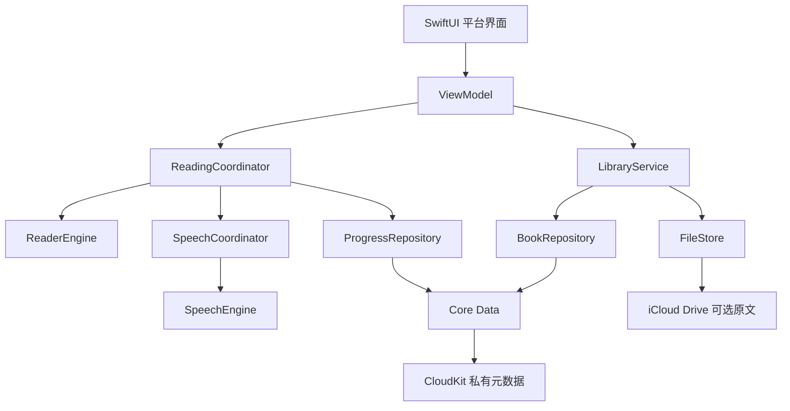
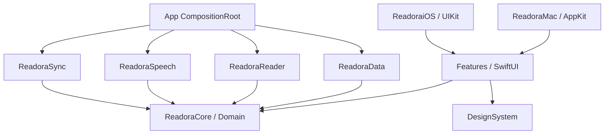
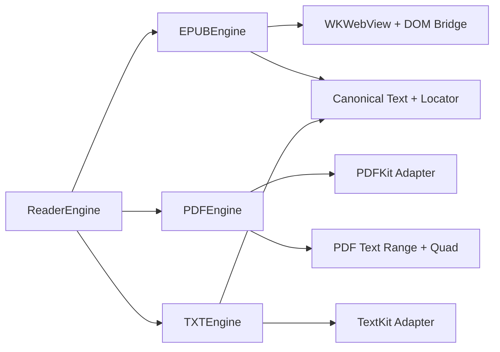
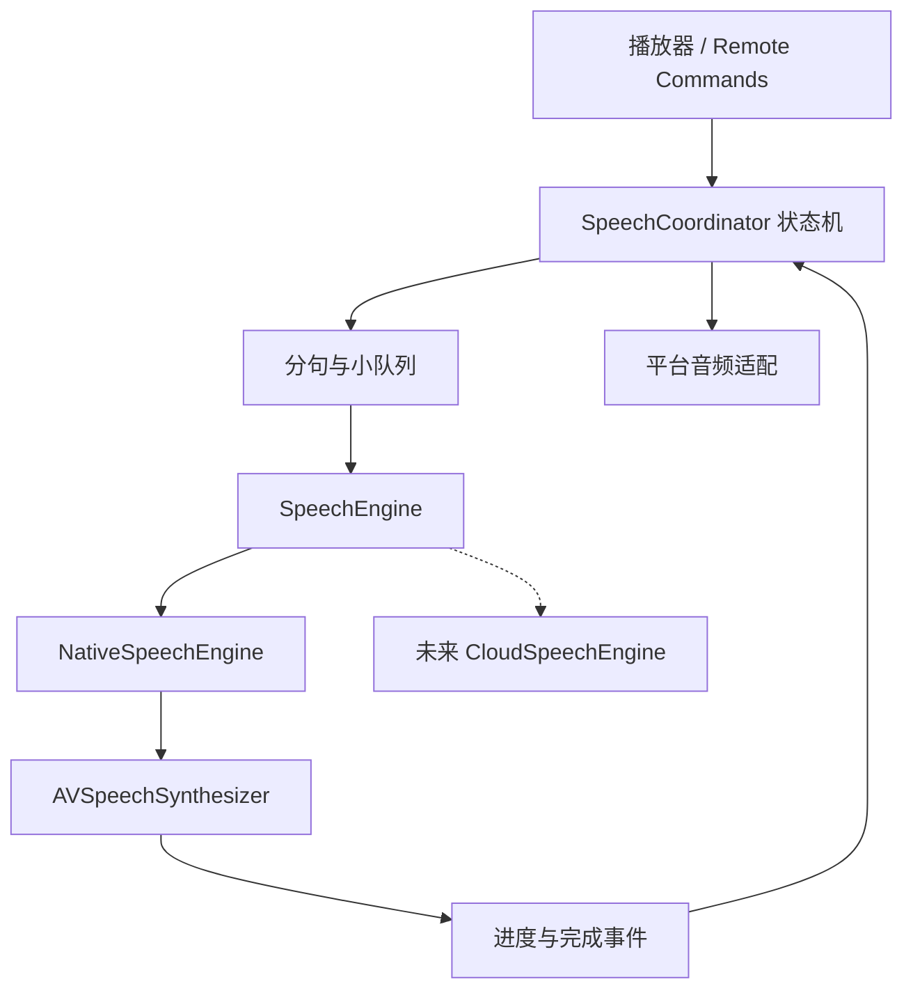
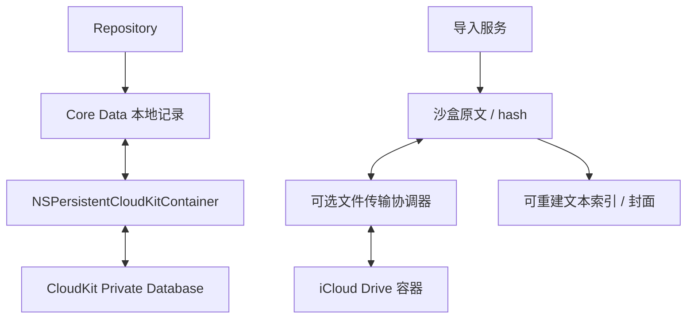
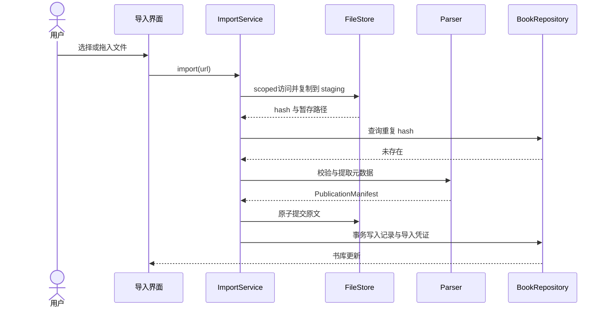
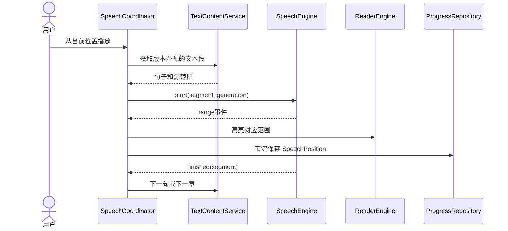

# 07 · 系统架构

采用轻量 MVVM + 领域协议 + 基础设施适配，不为每个按钮建立独立 use case。View 只处理布局和用户意图，ViewModel 为 MainActor 状态持有者；业务协调器处理跨阅读、朗读和进度的流程；引擎不直接写数据库。

## 1. 系统总体

只有组合根知道具体实现。Core Data 和 FileStore 是平行的数据通道，不能用「同步完成」掩盖原文仍未下载。错误在适配器转换为领域错误，最终由界面提供恢复操作。

## 2. 跨平台模块

箭头为编译依赖。Features 只依赖 Core 和 DesignSystem；App 组合根注入 Data/Reader/Speech/Sync 实例。平台桥接在对应模块条件编译文件中实现，不让 Domain 引入 UIKit。

## 3. 阅读引擎

统一接口表达打开、导航和能力，不强迫 PDF 提供字体重排。内容提取服务独立于可见视图，避免后台换章必须创建 WKWebView。

## 4. TTS 引擎

Coordinator 是播放状态唯一写入者，原生 delegate 转为带 session/generation 的事件；未来云端必须提供时间对齐能力或降级为段高亮。

## 5. 阅读与朗读数据流

高亮产生的可视事件带 speechFollow 来源，不作为新的手动阅读位置再次驱动朗读。阅读位置和朗读位置独立存储，通过明确用户动作切换，防止回路。

## 6. 本地与云端

索引和解压缓存不进云端；书籍元数据含 contentHash 关联文件，接收端需校验匹配。系统镜像的记录不得再由手写 CloudKit 客户端修改。

## 7. 导入时序

重复分支直接返回已有书并清理 staging。文件与数据库不能跨介质原子提交，因此必须用 journal 在崩溃后补偿，详见存储文档。

## 8. 朗读时序

range 不是硬实时音频时钟；句级高亮是首发承诺。章节预取与句子解析在后台，视图加载失败不应使纯听书停止；内容提取失败则暂停并提供重试。

## 生命周期和隔离

AppState 负责启动恢复与账户事件，WindowState 负责窗口位置；SpeechCoordinator 应用级单实例。ImportActor/IndexActor/FileStore 串行化各自可变资源；NSManagedObject 不跨 context/actor 传递，仅输出不可变快照。生命周期离开前台提交检查点，不能依赖应用退出回调一定执行。日志用 OSLog，书名、文本、路径默认 private。
