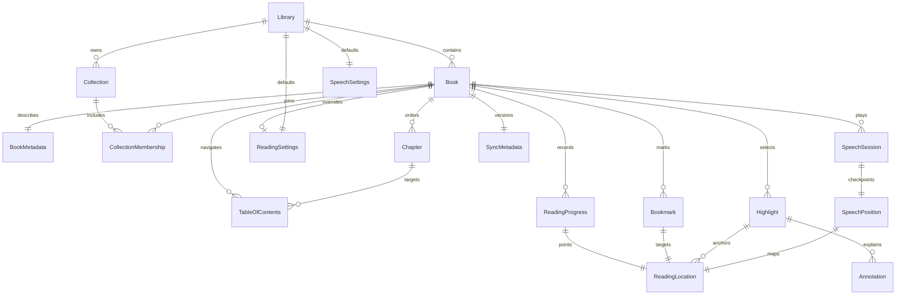

# 09 · 核心数据模型

## 模型与实体关系



图为领域关系，不要求每个值对象独立成 Core Data 实体。ReadingLocation/SpeechPosition/Settings 以版本化 Codable Data 保存；SyncMetadata 字段内嵌每个可同步实体。TableOfContents 是树形条目实体，parentID 可空，chapterID 指向 spine；无对应章节的外链只展示不可跳转。

## 字段合同与数据库映射

所有可同步行具有 UUID id、createdAt、updatedAt、deletedAt、schemaVersion、writerDeviceID。Core Data 属性有默认值或可选，关系可选且有 inverse，不依赖云端唯一约束；业务 UUID 去重由导入/合并协调器完成。

| 模型 | 核心字段与规则 |
|---|---|
| Library | id、name；首发每账户一个默认库，按固定逻辑 key 合并重复初始化 |
| Book | libraryID、contentHash(SHA-256)、format、metadataID、status、favorite、archivedAt、contentVersion；不保存跨设备绝对路径 |
| BookMetadata | title、authors JSON、language BCP-47、publisher、identifier、coverHash、source；手工编辑值优先解析结果 |
| Collection / Membership | name、sortOrder；membership 的逻辑 key 为 collectionID+bookID，重复可折叠；标签以 collection.kind=tag 表示 |
| Chapter | bookID、resourceID、spineIndex、title、canonicalUTF16Length、textVersion；解析派生记录本地重建 |
| TableOfContents | title、parentID、order、targetLocation；目录层级深度限制 32 |
| ReadingProgress | bookID、deviceID、sessionID、locationData、estimatedFraction、eventCounter、lastActiveAt；每设备/会话检查点，不简单全局覆盖 |
| Bookmark | bookID、locationData、label；同位置重复提示但不强行合并用户命名 |
| Highlight | bookID、start/end 位置、quote、prefix/suffix、color、contentVersion；跨章范围拆分 |
| Annotation | highlightID、body、revisionID、baseRevisionID；并发修订保留两个版本，UI 合并 |
| ReadingSettings | scope(global/book)、fontID、size、lineHeight、paragraphSpacing、margin、theme、layout；PDF 仅适用主题外壳/缩放策略 |
| SpeechSettings | voiceIdentifier、fallbackLanguage、normalizedRate、sleepPolicy；声音 ID 不跨设备保证有效 |
| SpeechSession | id、bookID、deviceID、engineID、state、startedAt、endedAt；播放状态仅本地，不能跨设备触发播放 |
| SpeechPosition | location、segmentID、utteranceUTF16Offset、textVersion、checkpointAt；云端只同步恢复锚点 |
| SyncMetadata | logicalID、writerDeviceID、eventCounter、deletedAt、schemaVersion；不是 CKRecord systemFields 的副本 |

本地文件状态 LocalBookAsset（bookID、relativePath、availability、verifiedHash）与设备声音选择、本地导入 journal 放非镜像 store。索引对 bookID/status/updatedAt 与 logical key 的查询建立普通 fetch index；云端 store 不依赖 unique constraint。FTS 为独立可删除 SQLite，不能修改 Core Data backing SQLite。

## Swift 领域示例

以下完整值定义是接口基线，未来文件按职责拆分；采用 Foundation 和最低系统已有类型。

```swift
import Foundation

enum BookFormat: String, Codable, Sendable { case epub, pdf, txt }
struct TextAnchor: Codable, Hashable, Sendable {
    let resourceID: String
    let utf16Offset: Int
    let utf16Length: Int
    let quote: String
    let prefix: String
    let suffix: String
    let textVersion: Int
}
struct PDFAnchor: Codable, Hashable, Sendable {
    let pageIndex: Int // 从 0 开始
    let utf16Offset: Int?
    let utf16Length: Int?
    let normalizedRects: [NormalizedRect]
}
struct NormalizedRect: Codable, Hashable, Sendable {
    let x: Double
    let y: Double
    let width: Double
    let height: Double
}
enum LocationAnchor: Codable, Hashable, Sendable {
    case text(TextAnchor)
    case pdf(PDFAnchor)
}
struct ReadingLocation: Codable, Hashable, Sendable {
    let bookID: UUID
    let contentHash: String
    let schemaVersion: Int
    let anchor: LocationAnchor
}
struct Book: Identifiable, Codable, Sendable {
    let id: UUID
    let contentHash: String
    let format: BookFormat
    var title: String
    var authors: [String]
}
struct SpeechPosition: Codable, Sendable {
    let location: ReadingLocation
    let segmentID: String
    let utteranceUTF16Offset: Int
    let checkpointAt: Date
}
```

EPUB resourceID 为规范化包内路径，不以解压绝对路径或页码定位；TXT 用稳定虚拟资源段 ID + 规范文本 UTF-16 偏移，另保留 byte-offset 索引用于加载。PDF rect 采用页面 crop box 归一化、左上原点，旋转显示时转换，附 pageIndex 与文本范围。所有 offset 必须边界校验；NSRange 不能直接当 Swift String.Index。

## 稳定定位与迁移

同一 contentHash/textVersion 下位置精确；字体变化只改变布局。内容变更不覆盖原文件，生成新 Book 版本；用户主动迁移时用 quote+上下文定位，歧义必须提示而非悄悄跳转。定位优先 resource+offset，校验 quote，失败在同章搜索上下文，再降级章首并提示「位置已近似恢复」。百分比仅展示，不做唯一恢复依据。

schemaVersion 覆盖 JSON payload，Core Data 模型单独递增版本。升级前备份，轻量迁移先用 N-1 数据测试；改文本规范化规则需增加 textVersion，旧锚点迁移前保留原索引。逻辑删除同步 tombstone；回收站默认 30 天，用户明确彻底删除后才清理原文，云端最终清除受系统调度影响，不宣称立即物理擦除。
